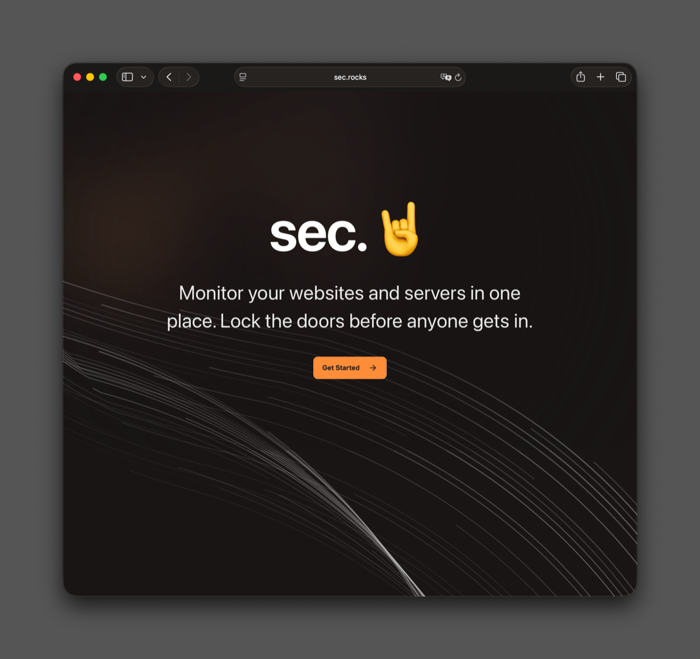

# OpenScan 🤘

<p align="center">
  
</p>

**OpenScan** is an open-source security scanning and asset discovery platform. It continuously monitors your internet-facing assets — domains, subdomains, IPs, and ports — and alerts you when things change.

> **"Monitor your websites and servers in one place. Lock the doors before anyone gets in."**

---

## Features

### 🔍 Asset Discovery
- **Subdomain Discovery** — Automatically discover subdomains and internet-facing assets using multiple tools
- **Host Discovery** — Ping sweeps and IP/CIDR range scanning to find live hosts
- **HTTP Service Probing** — Enrich discovered hosts with HTTP metadata (status codes, titles, headers, tech stack)

### 🔒 Port Scanning
- **Multi-Scanner Engine** — Combines **masscan** (ultra-fast, all ports), **rustscan** (fast with service detection), and **nmap** (deep fingerprinting) for comprehensive coverage
- **Smart Port Merging** — Deduplicates and merges results from multiple scanners automatically
- **Service Detection** — Identifies running services, versions, and operating systems
- **Scheduled Scanning** — Configurable scan schedules (QUICK, STANDARD, THOROUGH) with automatic retries and failure escalation

### 📊 Asset Inventory
- **Servers Dashboard** — Centralized view of all discovered servers with status filtering
- **Device Detail** — Per-device view with open ports, services, scan history, CVE vulnerabilities, and activity timeline
- **Tagging & Organization** — Organize assets by projects and tags

### 🛡️ Vulnerability Management
- **CVE Enrichment** — Automatically cross-references detected services with known CVEs
- **Severity Scoring** — CVSS-based severity classification (CRITICAL, HIGH, MEDIUM, LOW, INFO)
- **Vulnerability Timeline** — Track when vulnerabilities appear and get resolved

### 📬 Change Detection & Notifications
- **Real-time Change Detection** — Automatically detects new ports, closed ports, service drift, and CVE changes between scan runs
- **Email Alerts** — Rich HTML email notifications via **Resend** with categorized templates
- **Telegram Alerts** — Optional Telegram bot integration for instant notifications
- **Suppression Windows** — Configurable quiet periods to avoid alert fatigue
- **Notification Preferences** — Per-organization severity filtering for each channel

### 🖼️ Screenshot Capture
- **Browser Rendering** — Cloudflare Browser Rendering API captures live screenshots of web services
- **R2 Storage** — Screenshots stored in Cloudflare R2 for long-term retention

### 🏢 Hosting Provider Detection
- **IP Enrichment** — Automatically detects cloud/hosting providers for discovered IPs (AWS, GCP, Azure, DigitalOcean, etc.)

### 👥 Organization Management
- **Multi-tenant** — Organizations with member management and role-based access
- **Onboarding Flow** — Guided setup: create account → create project → asset discovery → notification configuration
- **Project Isolation** — Assets and scans scoped to projects within organizations

---

## Architecture

OpenScan uses a **distributed microservices architecture** with durable workflow orchestration:

```
┌─────────────────────────────────────────────────────────────────┐
│                        Cloudflare Workers                        │
│                                                                  │
│  ┌─────────────┐   ┌───────────────┐   ┌──────────────────────┐ │
│  │   Web App    │   │ Data Service  │   │ Screenshot Worker    │ │
│  │ (TanStack    │   │ (Notifications│   │ (Browser Rendering)  │ │
│  │  Start/React)│   │  Delivery)    │   │                      │ │
│  └──────┬───────┘   └──────┬────────┘   └──────────┬───────────┘ │
│         │                  │                        │             │
│         │    Cloudflare D1 (SQLite)                 │             │
│         │    Cloudflare R2 (Screenshots)            │             │
└─────────┼──────────────────┼────────────────────────┼─────────────┘
          │                  │                        │
          │     HTTP Postback (Universal Format)       │
          │                  │                        │
          ▼                  ▼                        ▼
┌──────────────────────────────────────────────────────────────┐
│                    Restate Worker                              │
│  ┌─────────────┐ ┌──────────────┐ ┌────────────────────────┐ │
│  │   Discovery  │ │ Port Scanner │ │  Scan Executor         │ │
│  │   Service    │ │ (masscan/    │ │  (Scheduled Scanning)  │ │
│  │              │ │  rustscan)   │ │                        │ │
│  └─────────────┘ └──────────────┘ └────────────────────────┘ │
│  ┌─────────────┐ ┌──────────────┐ ┌────────────────────────┐ │
│  │  HTTPx       │ │  Hosting     │ │  Device Scanner        │ │
│  │  Service     │ │  Enrichment  │ │  (Virtual Objects)     │ │
│  └─────────────┘ └──────────────┘ └────────────────────────┘ │
│              Durable Workflow Orchestration                   │
└──────────────────────────────────────────────────────────────┘
```

### Key Technologies

| Layer | Technology |
|-------|-----------|
| **Frontend** | TanStack Start (React 19) + TanStack Router + TanStack Query |
| **Styling** | Tailwind CSS v4 + Radix UI Primitives |
| **Workflow Orchestration** | [Restate](https://restate.dev/) — Durable execution engine |
| **Edge Compute** | Cloudflare Workers |
| **Database** | Cloudflare D1 (Serverless SQLite) |
| **ORM** | [Drizzle ORM](https://orm.drizzle.team/) — Type-safe SQL |
| **Auth** | [Better Auth](https://www.better-auth.com/) |
| **RPC** | tRPC v11 — End-to-end type-safe APIs |
| **Email** | [Resend](https://resend.com/) + React Email templates |
| **Validation** | Zod — Runtime type validation |
| **Package Manager** | pnpm workspaces |
| **Language** | TypeScript (strict mode) |

### Communication Pattern: Universal Postback

**Restate workers communicate with the web app via HTTP callbacks** — a simple, robust pattern:

1. Web app invokes a Restate workflow via HTTP API
2. Restate worker executes the durable workflow (scanning, discovery, etc.)
3. Worker sends results back via HTTP POST to the web app (the "postback")
4. Web app processes and persists the results

This decouples the scanning pipeline from the application layer, making each component independently deployable and testable.

---

## Project Structure

```
openscan/
├── apps/
│   ├── web/                      # 🌐 Main web application
│   │   ├── src/
│   │   │   ├── routes/           # TanStack file-based routing
│   │   │   ├── features/         # Feature modules (servers, scans, discovery, etc.)
│   │   │   ├── components/       # Reusable UI components (Radix + Tailwind)
│   │   │   ├── queries/          # TanStack Query + tRPC hooks
│   │   │   ├── modals/           # Modal dialogs
│   │   │   ├── server/           # Server functions & postback handlers
│   │   │   └── lib/              # Utilities, auth client, tRPC setup
│   │   ├── public/               # Static assets + _routes.json
│   │   ├── worker/               # Cloudflare Worker entry
│   │   └── wrangler.jsonc        # Cloudflare deployment config
│   │
│   ├── restate-worker/           # 🔄 Durable workflow orchestration
│   │   ├── src/
│   │   │   ├── discovery-service.ts     # Subdomain/host discovery
│   │   │   ├── port-scanner.ts          # Port scanning orchestrator
│   │   │   ├── device-scanner-service.ts# Scheduled scanning (Virtual Objects)
│   │   │   ├── scan-executor-service.ts # Scan execution logic
│   │   │   ├── httpx-service.ts         # HTTP service probing
│   │   │   ├── hosting-enrichment-service.ts # Cloud provider detection
│   │   │   ├── scanners/               # masscan, rustscan implementations
│   │   │   ├── xml-parser/             # Nmap XML result parsing
│   │   │   └── postback.ts             # Universal postback helper
│   │   └── src/__tests__/              # Integration & unit tests
│   │
│   ├── data-service/            # 📬 Notification delivery worker
│   │   ├── src/
│   │   │   └── index.ts         # Queue consumer + Hono API
│   │   ├── emails/              # React Email templates
│   │   └── wrangler.jsonc
│   │
│   └── screenshot-worker/       # 📸 Browser screenshot worker
│       ├── src/
│       │   ├── handlers/        # Capture, HTTPx, health endpoints
│       │   ├── services/        # Browser rendering, storage, postback
│       │   └── types/           # Environment & type definitions
│       └── wrangler.jsonc
│
├── packages/
│   ├── data-ops/                # 🗄️ Database operations (single source of truth)
│   │   ├── src/
│   │   │   ├── schema/          # Drizzle schema definitions
│   │   │   ├── queries/         # Database queries (devices, scans, notifications, etc.)
│   │   │   ├── auth/            # Better Auth server setup
│   │   │   └── database/        # D1 connection & initialization
│   │   └── migrations/          # SQL migrations
│   │
│   ├── contracts/               # 📋 Shared types, schemas, and contracts
│   │   ├── postbacks/           # Universal postback payload schemas
│   │   ├── scanners/            # Scanner configuration types
│   │   └── artifacts/           # Scan artifact types
│   │
│   ├── validation/              # ✅ Shared Zod validation schemas
│   ├── constants/               # 🔢 Shared constants & utilities
│   ├── config/                  # ⚙️ Shared configuration
│   └── logger/                  # 📝 Shared logging utilities
│
├── docs/                        # 📚 Documentation
│   ├── architecture/            # System architecture docs
│   ├── features/                # Feature-specific documentation
│   │   ├── notifications/       # Notification delivery system
│   │   ├── scans/               # Scan architecture
│   │   ├── discovery/           # Discovery workflow
│   │   └── ...
│   └── practices/               # Development guidelines
│
├── scripts/                     # Utility scripts
├── pnpm-workspace.yaml
├── tsconfig.base.json
└── README.md
```

---

## Prerequisites

- **Node.js 22.x** (required — the project uses `.nvmrc`)
- **pnpm 10+**
- **Wrangler CLI** — `npm install -g wrangler`
- **Restate** — Local or Cloud deployment ([docs](https://docs.restate.dev/))
- **Cloudflare account** — For D1, Workers, R2, and Queues

---

## Getting Started

```bash
# 1. Clone the repository
git clone https://github.com/your-org/openscan.git
cd openscan

# 2. Use the correct Node.js version
nvm use

# 3. Install dependencies and build shared packages
pnpm run setup

# 4. Set up environment variables
cp apps/web/.env.example apps/web/.env
cp apps/restate-worker/.env.example apps/restate-worker/.env

# 5. Run database migrations
cd packages/data-ops
pnpm drizzle-kit push
cd ../..
```

---

## Development

### Web Application

```bash
pnpm run dev:web
# Starts at http://localhost:13000
```

### Restate Worker

```bash
pnpm run dev:worker
# Starts Restate endpoint on port 9080
```

### Data Service (Notification Delivery)

```bash
cd apps/data-service
pnpm run dev
```

### Screenshot Worker

```bash
cd apps/screenshot-worker
pnpm run dev
```

---

## Deployment

### Web Application (Cloudflare Workers)

```bash
pnpm run deploy:web
```

### Data Service (Cloudflare Workers)

```bash
pnpm run deploy:data-service
```

### Screenshot Worker (Cloudflare Workers)

```bash
pnpm run deploy:screenshot-worker
```

### Restate Worker (Restate Cloud or Self-hosted)

Refer to `apps/restate-worker/README.md` for detailed deployment instructions.

---

## Notification Delivery System

OpenScan includes a comprehensive notification pipeline:

```
Port Scan Complete → Change Detection → Create Notifications
                                              ↓
                                    Filter by Org Severity Preferences
                                              ↓
                                    Enqueue to Cloudflare Queue
                                              ↓
                                    Data Service Consumes Queue
                                              ↓
                                    Send Emails via Resend + Telegram
```

**Supported Event Types:**
- 🔴 New critical/high-priority ports discovered
- 🟡 New CVEs detected on existing services
- 🔵 Service drift (version changes, product changes)
- ⚪ Closed/downtime ports
- 🟢 Server promoted from candidate to verified
- 📋 Batch scan summaries

See `docs/features/notifications/operations.md` for full details.

---

## Documentation

The `docs/` directory contains comprehensive documentation:

| Topic | Location |
|-------|----------|
| **Architecture Overview** | `docs/architecture/` |
| **Postback System** | `docs/architecture/backend/postback-architecture.md` |
| **Notification Delivery** | `docs/features/notifications/` |
| **Scan Architecture** | `docs/features/scans/` |
| **Discovery Workflows** | `docs/features/discovery/` |
| **Scheduled Scanning** | `docs/features/schedules/` |
| **Service Detection** | `docs/architecture/service-detection/` |
| **Optimistic UI Patterns** | `docs/optimistic-ui.md` |
| **Development Best Practices** | `docs/practices/` |

---

## Package Details

### `@repo/data-ops` — Database Operations

**Single source of truth** for all database queries. The golden rule: **never import database internals directly in apps** — always use exported query functions.

```typescript
// ✅ Correct
import { getDevicesForTenant, createDevicesInProject } from "@repo/data-ops";

// ❌ Wrong
import { getDb } from "@repo/data-ops/database/setup";
import { devices } from "@repo/data-ops/schema";
```

### `@repo/contracts` — Shared Types & Schemas

Domain types that serve as the single source of truth across UI, workers, and data-ops. Includes postback payload schemas with Zod runtime validation.

### Database

- **Cloudflare D1** (SQLite) with **Drizzle ORM**
- Schema-first approach with Zod validation at all layers
- CI/CD: Type-level tests catch schema drift across packages

---

## Testing

```bash
# Run all tests
pnpm -r test

# Restate worker tests (integration + unit)
cd apps/restate-worker
pnpm run test:run

# Data service tests
cd apps/data-service
pnpm run test

# Type checking
pnpm -r typecheck
```

---

## Contributing

We use [beads](https://github.com/steveyegge/beads) for dependency-aware issue tracking. All issues are prefixed with `sec-` (e.g., `sec-42`).

```bash
bd list -s open     # View open issues
bd ready            # See unblocked work
bd show sec-42      # View issue details
```

---

## License

ISC
